# Marquee

**Turn a Thermalright Trofeo Vision 9.16 LED panel into a living display for your Mac:** clocks,
weather, aircraft overhead, the planets, the news, your Claude Code day, a quill that writes a diary
in real handwriting, LED-grid scenes and more than 90 other programs. One menu-bar app, no vendor
software, and no panel needed to try it.

<p align="center">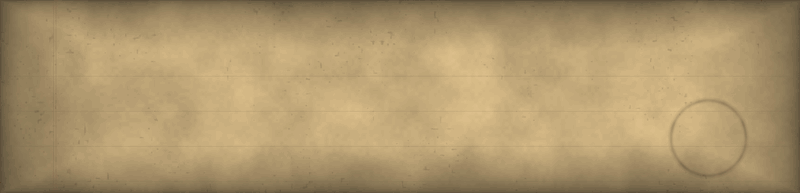</p>

<p align="center"><a href="https://github.com/justynroberts/marquee/releases/latest"><b>Download for macOS</b></a> ·
<a href="#get-started-in-a-minute">Get started</a> · <a href="#gallery">Gallery</a> ·
<a href="docs/GUIDE.md">Guide</a> · <a href="docs/API.md">API</a></p>

## Get started in a minute

1. **Install.** Download `Marquee-<version>.dmg` from
   [Releases](https://github.com/justynroberts/marquee/releases/latest), open it and drag
   **Marquee** to **Applications**. Signed and notarised; macOS 12 or later on Apple silicon.
2. **Open it.** A dot-matrix **M** appears in the menu bar (there is no Dock icon). Plug in the
   panel and it is picked up within a couple of seconds.
3. **No panel? No problem.** Rest the pointer on the **M** and a live mini view of the display
   opens at the top of the screen. Everything renders without hardware, so you can try every
   program before the panel arrives.
4. **Take the tour.** Menu → **Play → Playlists → showcase** walks through every feature with a
   title card before each part. Or pick something from **News & info**, **Claude**, **Diary** or
   **Scenes**.
5. **Open the remote.** Menu → **Open Remote** (<http://127.0.0.1:7781>) plays programs, flashes
   alerts, edits the message board, starts timers, lets you draw and shows a live preview.
6. **Make it yours.** Menu → **Settings…** sets your location, cities, feeds, coins, dates and
   station, and checks each one as you save it. Leave the location empty to use where you are.
7. **Let Claude drive it.** `claude mcp add marquee -- /Applications/Marquee.app/Contents/MacOS/marquee mcp`
   and ask Claude to flash a build result, play the weather or build you a playlist.

<p align="center">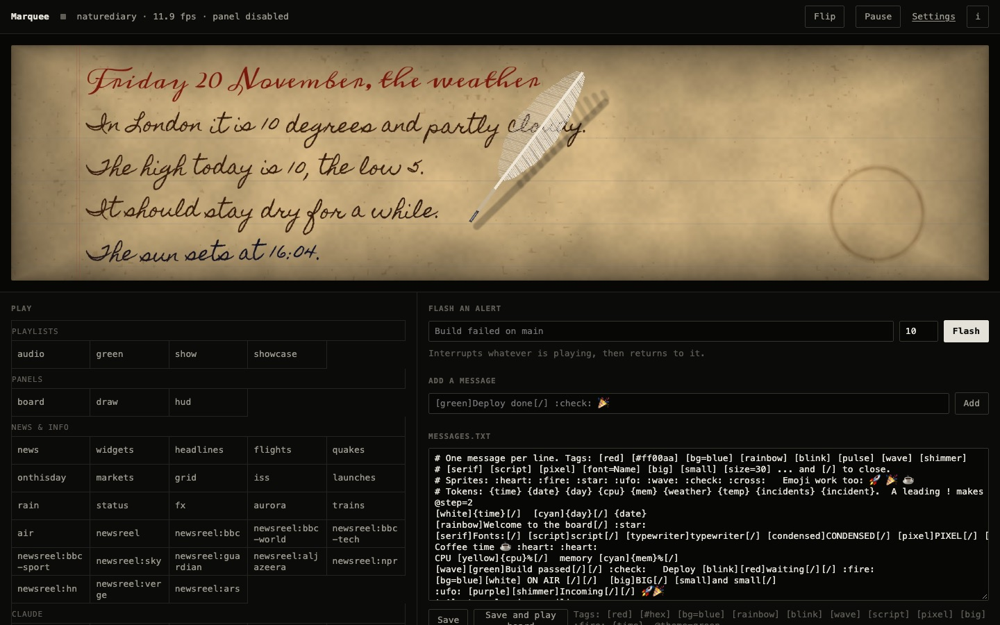<br><sub>The web remote, with the live preview at the top</sub></p>

## Gallery

Every image here is a real frame from Marquee at the panel's 1920 x 462.

<table>
<tr><td width="50%">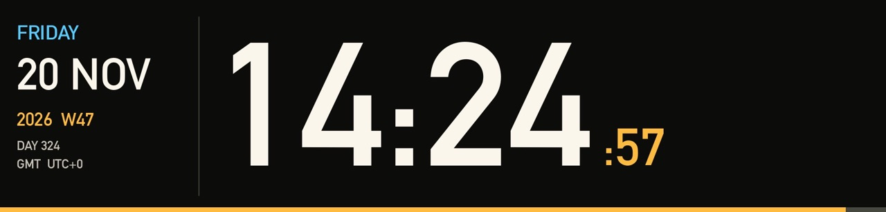bigclock</code>: the time, as large as the panel allows"><br><sub><code>bigclock</code>: the time, as large as the panel allows</sub></td><td width="50%">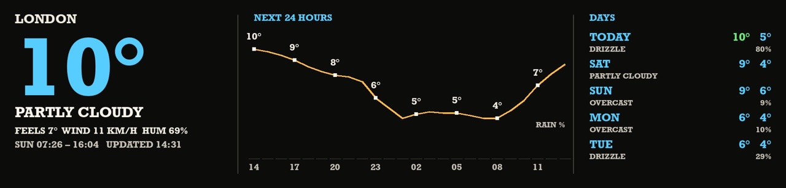weather</code>: now, the next 24 hours and the days ahead"><br><sub><code>weather</code>: now, the next 24 hours and the days ahead</sub></td></tr>
<tr><td width="50%">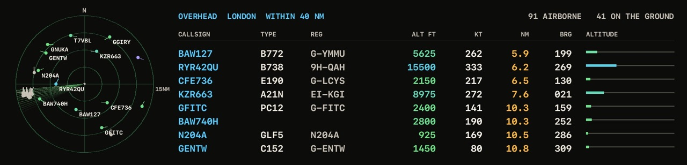flights</code>: aircraft overhead on a live radar"><br><sub><code>flights</code>: aircraft overhead on a live radar</sub></td><td width="50%">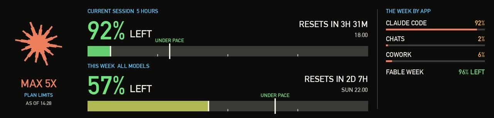claudelimits</code>: how much of your Claude plan is left"><br><sub><code>claudelimits</code>: how much of your Claude plan is left</sub></td></tr>
<tr><td width="50%">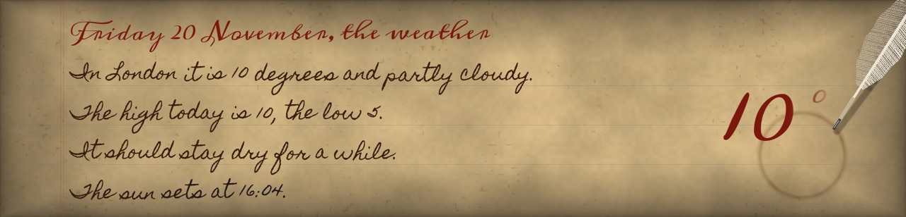naturediary</code>: a quill keeps a nature diary"><br><sub><code>naturediary</code>: a quill keeps a nature diary</sub></td><td width="50%">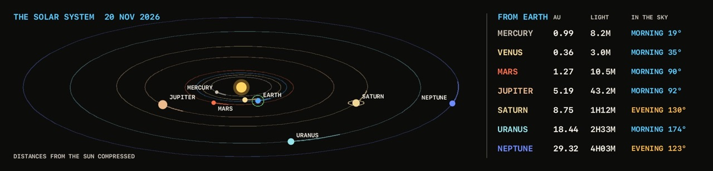orrery</code>: the planets right now"><br><sub><code>orrery</code>: the planets right now</sub></td></tr>
<tr><td width="50%">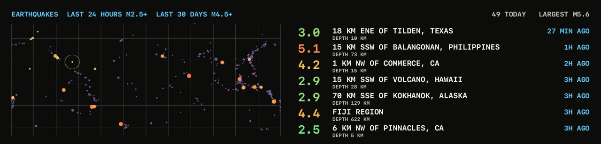quakes</code>: the world's earthquakes, live from the USGS"><br><sub><code>quakes</code>: the world's earthquakes, live from the USGS</sub></td><td width="50%">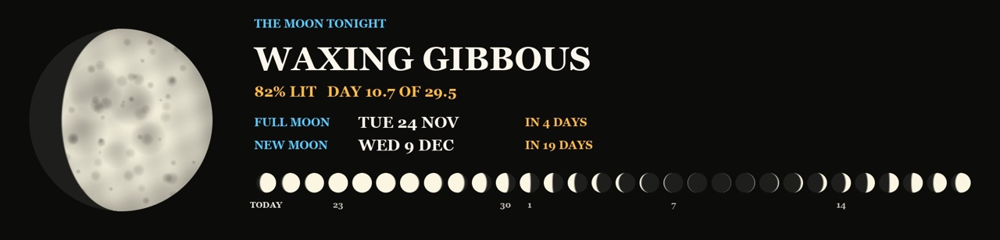moon</code>: tonight's phase and the month ahead"><br><sub><code>moon</code>: tonight's phase and the month ahead</sub></td></tr>
<tr><td width="50%">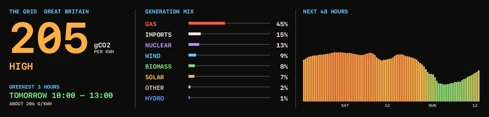grid</code>: how green the electricity is right now"><br><sub><code>grid</code>: how green the electricity is right now</sub></td><td width="50%">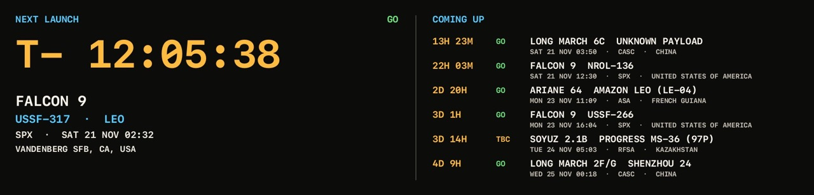launches</code>: rocket launches with a live countdown"><br><sub><code>launches</code>: rocket launches with a live countdown</sub></td></tr>
<tr><td width="50%">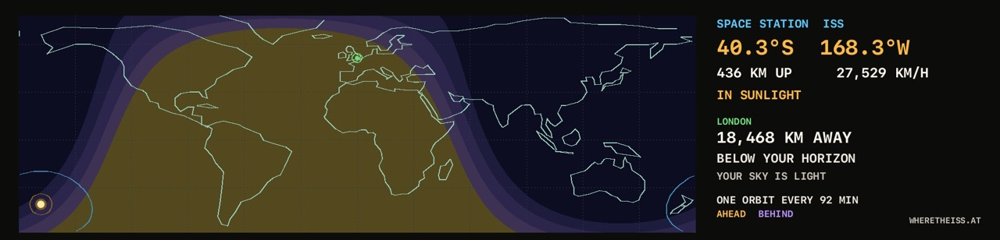iss</code>: the space station's track and distance from you"><br><sub><code>iss</code>: the space station's track and distance from you</sub></td><td width="50%">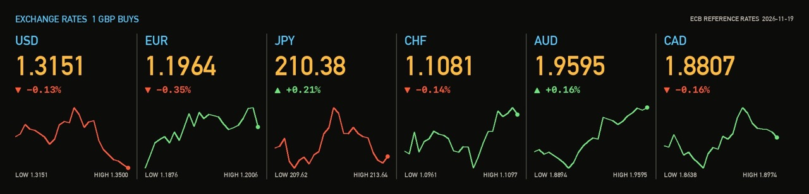fx</code>: exchange rates and 30 days of moves"><br><sub><code>fx</code>: exchange rates and 30 days of moves</sub></td></tr>
<tr><td width="50%">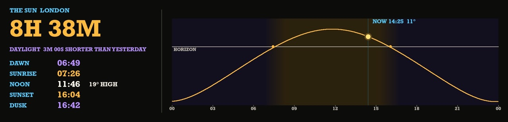sun</code>: dawn to dusk and the sun's path today"><br><sub><code>sun</code>: dawn to dusk and the sun's path today</sub></td><td width="50%">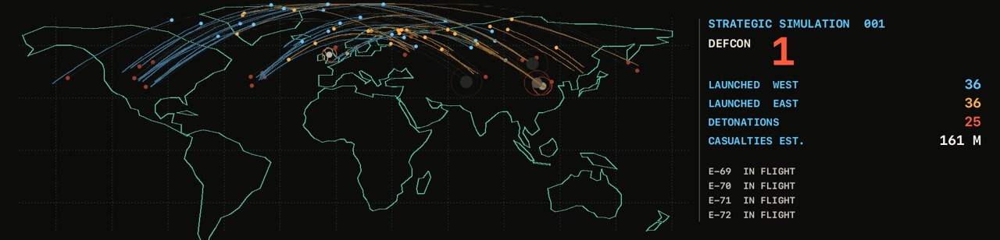warroom</code>: a cold-war simulation with no winner"><br><sub><code>warroom</code>: a cold-war simulation with no winner</sub></td></tr>
<tr><td width="50%">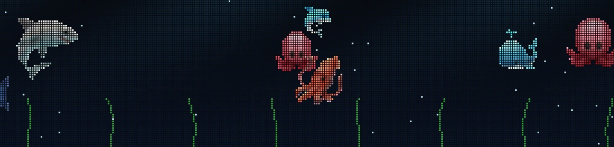aquarium</code>: one of the LED-grid scenes"><br><sub><code>aquarium</code>: one of the LED-grid scenes</sub></td><td width="50%">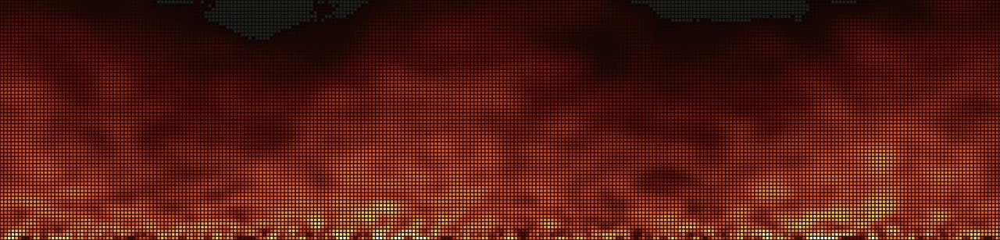fire</code>: round LEDs, 275 x 66 of them"><br><sub><code>fire</code>: round LEDs, 275 x 66 of them</sub></td></tr>
<tr><td width="50%">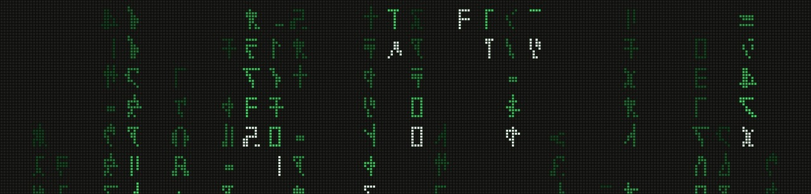matrix</code>"><br><sub><code>matrix</code></sub></td><td width="50%">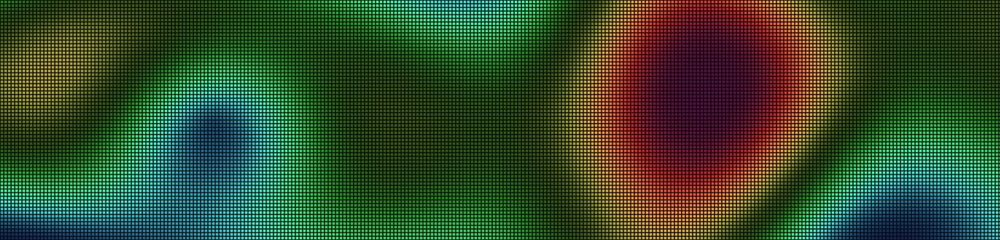plasma</code>"><br><sub><code>plasma</code></sub></td></tr>
<tr><td width="50%">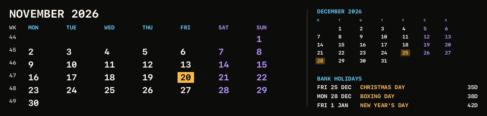calendar</code>: the month, with bank holidays"><br><sub><code>calendar</code>: the month, with bank holidays</sub></td><td width="50%">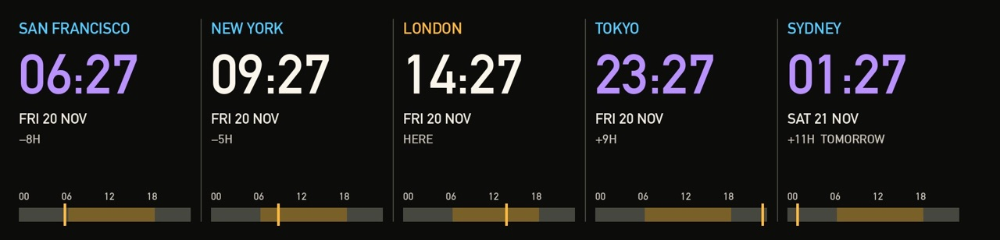worldclock</code>: your cities, with day and night"><br><sub><code>worldclock</code>: your cities, with day and night</sub></td></tr>
<tr><td width="50%">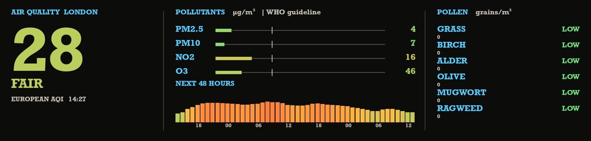air</code>: air quality and pollen"><br><sub><code>air</code>: air quality and pollen</sub></td><td width="50%">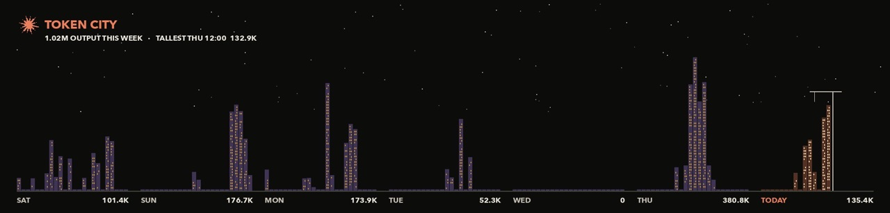claudecity</code>: your week of Claude Code as a skyline"><br><sub><code>claudecity</code>: your week of Claude Code as a skyline</sub></td></tr>
<tr><td width="50%">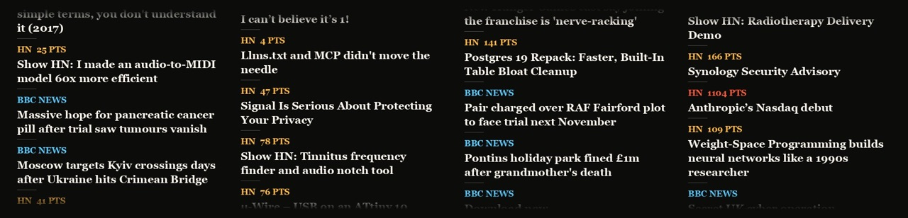headlines</code>: a slowly scrolling news wall"><br><sub><code>headlines</code>: a slowly scrolling news wall</sub></td><td width="50%">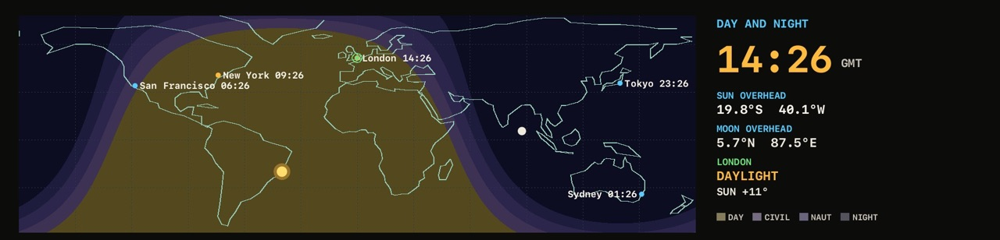daynight</code>: the day/night line across the world"><br><sub><code>daynight</code>: the day/night line across the world</sub></td></tr>
</table>

## Permissions

Requires macOS 12 or later on Apple silicon. The app is signed and notarised, so it opens without
a Gatekeeper warning.

macOS asks for permissions the first time a feature needs them:

| Permission | Asked when | Why |
|---|---|---|
| Microphone | an audio visualiser first plays | The visualisers analyse live sound. Nothing is recorded or sent anywhere. The microphone is released 10 seconds after the last visualiser stops. |
| Camera | a camera scene first plays | The camera scenes draw the webcam on the panel. Nothing is recorded or sent anywhere. The camera is released 10 seconds after the last camera scene stops. |
| Automation (Music, Spotify) | `nowplaying`, `karaoke` or the HUD first looks for a track | Marquee asks Music and Spotify what is playing. It never changes anything in them, and never launches a player that is not running. |
| Location | `weather`, `flights`, `air`, `sun` or `grid` first plays without a place in `weather.txt` | Shows the weather, air, aircraft, daylight and grid where you are. Marquee asks for an approximate fix and rounds it to about a kilometre before sending it to Open-Meteo, adsb.lol or postcodes.io; `grid` sends only the postcode district (e.g. SW1A). |
| Local Network | you turn on **Allow Other Devices** | Other devices can then reach the panel, and Marquee advertises itself over Bonjour. |

If you said no by mistake, see [Troubleshooting](docs/GUIDE.md#troubleshooting).

Marquee checks GitHub Releases once a day. When a newer version is out, the menu shows **Download Marquee x.y.z…**, which downloads the signed disk image; **Check for Updates…** checks now.

## Everyday use

- **Menu bar → Play** lists everything that can play, grouped into Playlists, Panels, News & info,
  Claude, Diary, Scenes, Audio and Camera.
- The rest of the menu: Brightness, Pause, Upside Down (for a panel mounted the other way up),
  HUD Mode, HUD Lyrics, Clear Alert, Allow Other Devices, Require Key on This Mac, New API Key…,
  Settings…, API Reference, Open at Login and Show Data Folder.

Your files live in `~/Library/Application Support/Marquee` (messages, schedule, playlists, media,
keys). Logs go to `~/Library/Logs/Marquee/marquee.log`.

## Features

- **Scenes**: matrix, terminal, fire, life, warp, plasma, rain, clock, bounce, fireworks,
  aquarium, drawn on a 275 x 66 grid of round LEDs.
- **Audio visualisers**: spectrum, mirror, waterfall, scope, pulse and meter, from the microphone.
- **Camera scenes**: camera, popart, motion and slitscan, from the webcam, and interactive ones
  that see you: snowfall (settles on you), bubbles (pop them) and airpaint (pinch to draw). Also
  thermal (a heat camera), kaleido (a kaleidoscope) and ascii (you, drawn in text).
- **Message board** (`board`): `messages.txt`, one message per line, with colours, backgrounds,
  effects, fonts, sizes, animated sprites, colour emoji, live tokens such as `{time}`, `{cpu}` and
  `{weather}`, and green or amber phosphor themes. See [docs/BOARD.md](docs/BOARD.md).
- **Dashboard** (`dashboard`): clock, CPU, memory, network and machine details at the panel's full
  resolution, so small text stays sharp.
- **Interference** (`interference`): drifting wave sources drawn as contour bands, full
  resolution.
- **Clocks** (`bigclock`, `worldclock`): a full-resolution clock as large as the panel allows, and
  clocks for several cities with day/night strips (`world-clock.txt` picks the cities).
- **Weather** (`weather`): now, the next 24 hours and the coming days from
  [Open-Meteo](https://open-meteo.com), for the place in `weather.txt`.
- **Headlines** (`headlines`): a news wall, every headline in small type in four slowly scrolling
  columns, from the same sources as the `news` ticker.
- **Flights** (`flights`): planes overhead on a radar, live from [adsb.lol](https://adsb.lol),
  with callsign, type, altitude, speed and distance.
- **Earthquakes** (`quakes`): the world's quakes from the USGS on a map, the latest listed.
- **On this day** (`onthisday`): Wikipedia's history for today, one event at a time.
- **Moon** (`moon`): tonight's phase drawn large, the next full and new moons, the coming month.
- **Word clock** (`wordclock`) and **calendar** (`calendar`, with UK bank holidays).
- **Markets** (`markets`): crypto prices from CoinGecko with the day's move and the week.
- **War room** (`warroom`): a cold-war strategic simulation on a vector map that always ends the
  same way, with no winner.
- **Claude Code** (`claude`): today's tokens by kind, output by the hour, the last seven days,
  and the sessions running now with how full each conversation is, read from Claude Code's own
  history on this Mac. Three playful versions of the same: `claudehive` (each session an orb
  throwing sparks into the Claude spark), `claudecity` (your week as a skyline, a tower an hour)
  and `claudeflow` (today's output as a river by project); and large ones: `claudeclock` (the
  spark as a 24-hour clock), `claudeorbit` (sessions as planets), `claudeburst` (a firework per
  reply) `claudemeter` (three big gauges) `claudelimits` (how much of your Pro or Max plan is left) and `claudediary` (a quill writes Claude's diary on an old page, then the ink soaks away). `diary` is the same page as a day book of weather, headlines, history, daylight, the moon and quotations, and `commonplace`, `naturediary` and `newsdiary` are narrower books on the same page.
- **Widgets** (`widgets`): a board of readings anything can post (`POST /v1/widgets`), and an
  ntfy relay so cloud tools such as Grok Bot can post too.
- **Live Claude** (`claudelive`): what each Claude Code session is doing this moment, from a
  hook (`scripts/claude-hook.sh`).
- **Desk tools**: `progress` (the hour, day, week, month and year as live progress bars),
  `pomodoro` (a focus timer, lengths in `focus.txt`), `netwatch` (latency and loss to your
  router, Cloudflare and Google, and DNS time) and `status` (status pages for GitHub,
  Cloudflare, Anthropic and others, list in `status.txt`).
- **Rain** (`rain`): will it rain in the next two hours, in 15-minute steps, and the next 12.
- **Space**: `iss` (the space station's ground track, height, speed and distance from you),
  `launches` (rocket launches with a live countdown), `orrery` (the planets now, from above)
  and `daynight` (the day/night terminator on a world map, with the world-clock cities).
- **Exchange rates** (`fx`): currencies against your base with the day's move and 30 days.
- **Settings** (menu → **Settings…**): one page for your location, cities, feeds, coins, dates,
  station and keys, each checked as you save it.
- **Trains** (`trains`): live departures and arrivals for a station (Long Eaton by default) from
  National Rail, with a free [Rail Data Marketplace](https://raildata.org.uk) key.
- **Sun** (`sun`), **grid** (`grid`: carbon intensity and generation mix where you are) and
  **aurora** (`aurora`: AuroraWatch UK and NOAA's Kp forecast).
- **Neon** and **clones** (`neon`, `clones`): you as glowing outlines, or trailed by delayed
  copies in colour.
- **Air quality** (`air`): AQI, pollutants and pollen for the weather place, and the next 48 hours.
- **Flock** (`flock`): a murmuration of birds wheeling across the LED grid.
- **Countdown** (`countdown`): days to go until the dates in `countdown.txt`.
- **Newsreel** (`newsreel`): one source crawling across the panel in mid-size type on two rows.
  BBC News by default; `newsreel:sky`, `newsreel:hn`, `newsreel:guardian` and others pick a
  preset, and `newsreel.txt` takes any RSS or Atom URL.
- **Now Playing** (`nowplaying`): artwork, title, artist, album and a progress bar from Music or
  Spotify.
- **Karaoke** (`karaoke`): time-synced lyrics from [LRCLIB](https://lrclib.net), each line lighting
  up as it is sung. Only the title, artist, album and length are sent.
- **HUD mode** (`hud`): black with bold white type, a huge clock and one line, mirrored so it reads
  correctly reflected in your monitor. Can show lyrics instead of the clock.
- **News ticker** (`news`): Hacker News headlines, or any RSS and Atom feeds you list.
- **Alerts and timers**: flash text over whatever is playing, or run a countdown.
- **PagerDuty**: new triggered incidents flash on the panel; `{incidents}` and `{incident}` show
  the current state on the board.
- **Webhooks**: a generic hook that flashes any text, and a GitHub hook for failed workflow runs,
  releases, new issues and pull requests, merges and stars.
- **Playlists**: built-in `show`, `green` and `audio`, plus your own.
- **Schedule**: `schedule.txt` runs actions at set times every day.
- **Media**: upload PNG, JPEG, GIF or WebP (animated GIF and WebP play at their own timing), or
  push frames from your own app.
- **Drawing pad** (`draw`): paint on the LED grid from the web remote.
- **Showcase** (`showcase`): the tour.

The feature guide is [docs/GUIDE.md](docs/GUIDE.md).

## HTTP API

Everything the menu and remote can do is available over HTTP on port 7781. Requests from the Mac
running Marquee need no key. Requests from other devices need **Allow Other Devices** turned on and
an API key (menu → **New API Key…**, or `marquee key create NAME`), sent as
`Authorization: Bearer mq_…`.

```bash
M=http://127.0.0.1:7781
curl -X POST $M/v1/flash -H 'Content-Type: application/json' -d '{"text":"Build failed 🔥","seconds":10}'
curl -X POST $M/v1/play  -H 'Content-Type: application/json' -d '{"program":"matrix"}'
curl -X POST $M/v1/messages -H 'Content-Type: application/json' -d '{"text":"[green]Deployed :check: {time}"}'
curl -X POST $M/v1/frame -H 'Content-Type: image/png' --data-binary @chart.png
curl -N $M/v1/events
```

Full reference: [docs/API.md](docs/API.md). The running server describes itself at
`GET /v1/openapi.json`.

## Command line

The binary inside the app is `/Applications/Marquee.app/Contents/MacOS/marquee`. Link it onto your
`PATH` if you want to type `marquee`:

```bash
sudo mkdir -p /usr/local/bin
sudo ln -sf /Applications/Marquee.app/Contents/MacOS/marquee /usr/local/bin/marquee
```

```bash
marquee status                          # what is playing
marquee play NAME                       # show, green, audio, board, dashboard, matrix, ...
marquee flash TEXT [--seconds N] [--colour C]
marquee say TEXT                        # add a message to the board
marquee timer MINUTES [LABEL]
marquee hud on|off|clear|TEXT
marquee hud mirror horizontal|vertical|off
marquee hud lyrics on|off
marquee lyrics [earlier|later|SECONDS]  # lyric timing, 0.25 s steps
marquee send FILE                       # show an image now
marquee key create NAME | key list | key revoke ID
marquee mcp                             # MCP server for Claude
marquee serve [--addr ADDR] [--lan] [--no-panel] [--data DIR] [--require-key]
marquee info | colour RRGGBB | image FILE | bench   # direct to the panel, no server
marquee version
```

The client commands talk to the running server. `MARQUEE_URL` and `MARQUEE_KEY` point them at
another machine. The direct commands open the panel themselves, so they only work while Marquee is
not running.

## Use from Claude (MCP)

`marquee mcp` is a Model Context Protocol server on stdin/stdout. It talks to the running Marquee
over the HTTP API, so Claude can check the status, play programs, flash alerts, write the message
board, manage playlists, drive the HUD, show images and look at a live preview of the panel.

```bash
claude mcp add marquee -- /Applications/Marquee.app/Contents/MacOS/marquee mcp
```

Claude Desktop and remote panels: [docs/GUIDE.md](docs/GUIDE.md#mcp-claude-code-and-claude-desktop).

## Documentation

- [docs/GUIDE.md](docs/GUIDE.md): feature guide, data folder, network access, troubleshooting
- [docs/BOARD.md](docs/BOARD.md): message board markup
- [docs/API.md](docs/API.md): HTTP API reference
- [docs/DEVELOPMENT.md](docs/DEVELOPMENT.md): architecture, building, testing, releasing
- [docs/PROTOCOL.md](docs/PROTOCOL.md): the panel's USB protocol

## Build from source

```bash
brew install libusb go
go build -o bin/marquee ./cmd/marquee      # libusb linked statically; FreeType and HarfBuzz are vendored
go test ./...
bin/marquee serve                          # server and web remote, without the menu bar
```

`scripts/release.sh --local` builds a signed `Marquee.app` in `dist/`. Details in
[docs/DEVELOPMENT.md](docs/DEVELOPMENT.md). `marquee serve` also runs on Linux with libusb; the
menu-bar app is macOS only.

## Credits and licence

MIT licence, see `LICENSE`. Made by FintonLabs. Not affiliated with Thermalright.

Output is pixel-compatible with the original Python version: text is rasterised with the same
FreeType and HarfBuzz versions Pillow uses, emoji come from Apple Color Emoji exactly as Pillow
draws them, and resampling and line drawing are ports of Pillow's own code.

Includes FreeType 2.14.3 (FreeType Licence), HarfBuzz 14.5.0 (Old MIT), algorithms ported from
Pillow 13 (HPND), and a JPEG encoder derived from Go's `image/jpeg` (BSD). Emoji: Apple Color Emoji
from the system on macOS; [Twemoji](https://github.com/jdecked/twemoji) (CC-BY 4.0) elsewhere.
Handwriting in the diaries: [Homemade Apple](https://fonts.google.com/specimen/Homemade+Apple)
(Apache 2.0) and [Meddon](https://fonts.google.com/specimen/Meddon) (SIL OFL).
Weather from [Open-Meteo](https://open-meteo.com); lyrics from [LRCLIB](https://lrclib.net);
aircraft from [adsb.lol](https://adsb.lol) (ODbL); earthquakes from the USGS; "on this day" from
Wikipedia (CC BY-SA); prices from CoinGecko; air quality from Open-Meteo (CAMS); bank holidays
from gov.uk (OGL); carbon intensity from NESO; aurora from AuroraWatch UK
(Lancaster University) and NOAA SWPC; the ISS position from wheretheiss.at; launches from
The Space Devs' Launch Library 2; exchange rates from the ECB via Frankfurter; service status
from each service's public status page; postcode districts from postcodes.io; train times from National Rail
(Darwin, via the Rail Data Marketplace). The
licence texts ship in `Marquee.app/Contents/Resources`.
